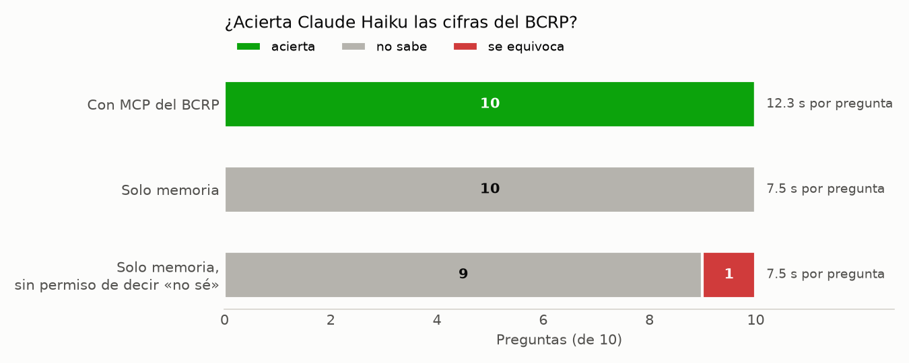

# Informe · ¿Le sirve a Claude un MCP del BCRP?

Le hice las mismas 10 preguntas sobre cifras del BCRP a Claude Haiku (`claude -p`, 28 de octubre de 2026) de dos formas:
solo con lo que sabe de memoria y con mi servidor MCP (`server.py`). Las 8 primeras preguntas vienen del curso; las dos
últimas son mías: el precio del oro de agosto de 2026 (`PN38793BM`) y la tasa de desempleo de Lima de setiembre de
2026 (`PN38063GM`).



## Resultados

| Modo | Acierta | No sabe | Se equivoca | Segundos promedio |
|---|---:|---:|---:|---:|
| Solo memoria | 0 | 10 | 0 | 7.5 |
| MCP del BCRP | 10 | 0 | 0 | 12.3 |
| Solo memoria, sin la frase «pon valor null» (experimento extra) | 0 | 9 | 1 | 7.5 |

Detalle en `resultados.csv` (corrida base) y `resultados_sin_null.csv` (experimento).

## Qué acertó y qué no, y por qué

- **Con MCP acertó las 10.** En cada respuesta la columna `fuente` trae el código de la serie, el periodo y la URL de
  la API del BCRP, por ejemplo `https://estadisticas.bcrp.gob.pe/estadisticas/series/api/PN01273PM/json/2026-8/2026-10`.
  Usó entre 4 y 6 turnos: primero `buscar_series` para encontrar el código y después `serie` o `resumen`. Tarda unos
  5 segundos más por pregunta que de memoria, que es el costo de esas llamadas.
- **De memoria no acertó ninguna.** Respondió «no sé» en las 10 porque su conocimiento llega a junio de 2026 y casi
  todas las preguntas son de meses posteriores. Incluso las de 2025 (inflación de marzo y diciembre, PBI anual) las
  dejó en null: la instrucción le permitía no estimar y la usó.
- **Experimento extra (sin permiso de decir «no sé").** Quité de `INSTRUCCION` la frase «Si no puedes saberlo con
  certeza, pon valor null: no estimes.» Haiku siguió negándose en 9 de 10, pero en una **inventó una cifra**: dijo que
  el IPC de Lima subió 0.2 % en marzo de 2025, cuando la cifra oficial es 0.81 %. La presentó como «estimación de
  memoria, no verificada», pero en una tabla automática ese 0.2 habría pasado como dato. Es justo la pregunta de 2025
  que podría «recordar», y ahí es donde se equivoca con seguridad.

## Dos cifras comprobadas a mano en la web del BCRP

Las verifiqué el 28 de octubre de 2026 en la web de estadísticas del BCRP, que muestra un solo decimal.

| Pregunta | Mi MCP dijo | La web del BCRP dice | ¿Coincide? | Tabla donde la vi |
|---|---:|---:|:-:|---|
| Precio del oro, agosto de 2026 (US$ por onza troy) | 4,411.15 | 4,411.1 | ✅ | [PN38793BM](https://estadisticas.bcrp.gob.pe/estadisticas/series/mensuales/resultados/PN38793BM/html) |
| Desempleo de Lima, setiembre de 2026 (%, promedio móvil 3 meses) | 4.37 | 4.4 | ✅ | [PN38063GM](https://estadisticas.bcrp.gob.pe/estadisticas/series/mensuales/resultados/PN38063GM/html) |

La diferencia es solo de redondeo: la API entrega el valor completo (4,411.1467 y 4.3717) y la web lo redondea a un
decimal. Las dos quedan dentro de la tolerancia de `preguntas.csv` (±20 US$ y ±0.05 puntos).

## La herramienta propia: `comparar_paises`

El BCRP solo publica datos del Perú, así que agregué una herramienta que trae indicadores anuales del Banco Mundial
para comparar con otros países (crecimiento del PBI, inflación, desempleo, exportaciones). Devuelve la URL de la API
del Banco Mundial como fuente. Por ejemplo, en 2025 el PBI creció 3.43 % en el Perú, 2.46 % en Chile y 2.64 % en
Colombia; la cifra del Perú coincide con la del BCRP (`PM04923AA`, 3.43 %).

## Conclusión

Un MCP vale la pena cuando las preguntas se repiten sobre una misma fuente oficial y cada cifra tiene que poder
rastrearse: aquí acertó todo y cada respuesta trae el código de la serie y la URL para verificarla. Sin herramientas el
modelo no sirve para datos recientes, y si se le quita la opción de decir que no sabe, puede inventar. La búsqueda web
basta para una pregunta suelta, pero depende de encontrar la página correcta y es más lenta (en la clase tardó 25.9 s
por pregunta frente a 7.8 s del MCP). Si los datos cambian cada mes y se consultan a menudo, conviene el MCP.

## Cómo repetirlo

```bash
uv run pytest -q          # 8 passed
uv run evaluar.py         # escribe resultados.csv
uv run grafico.py         # escribe grafico.png
```
