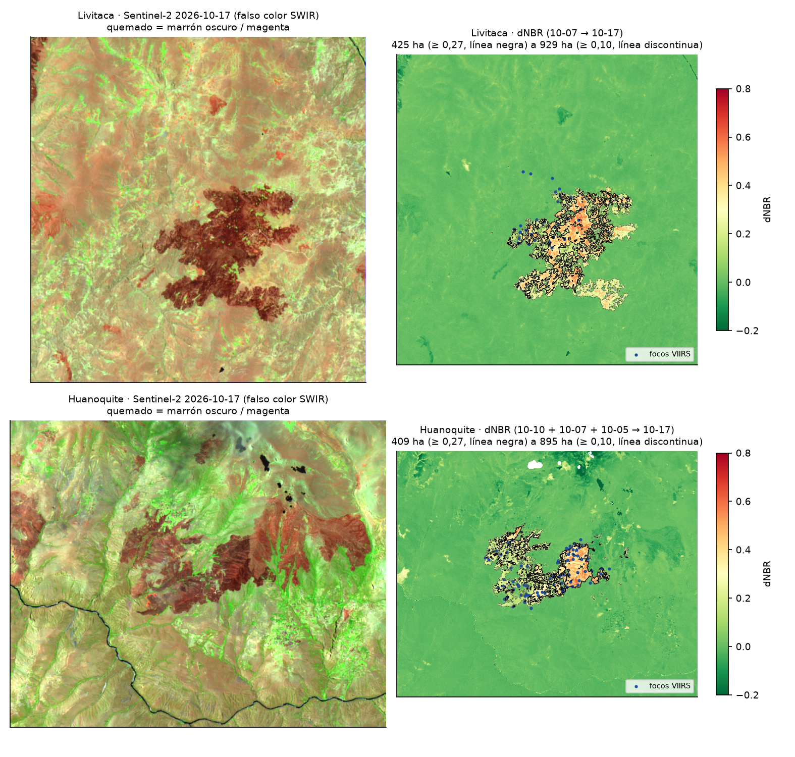
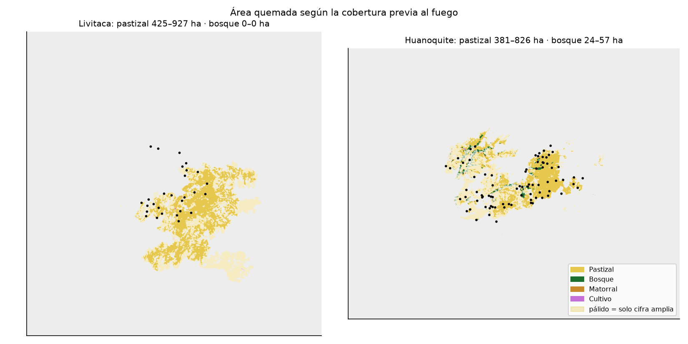
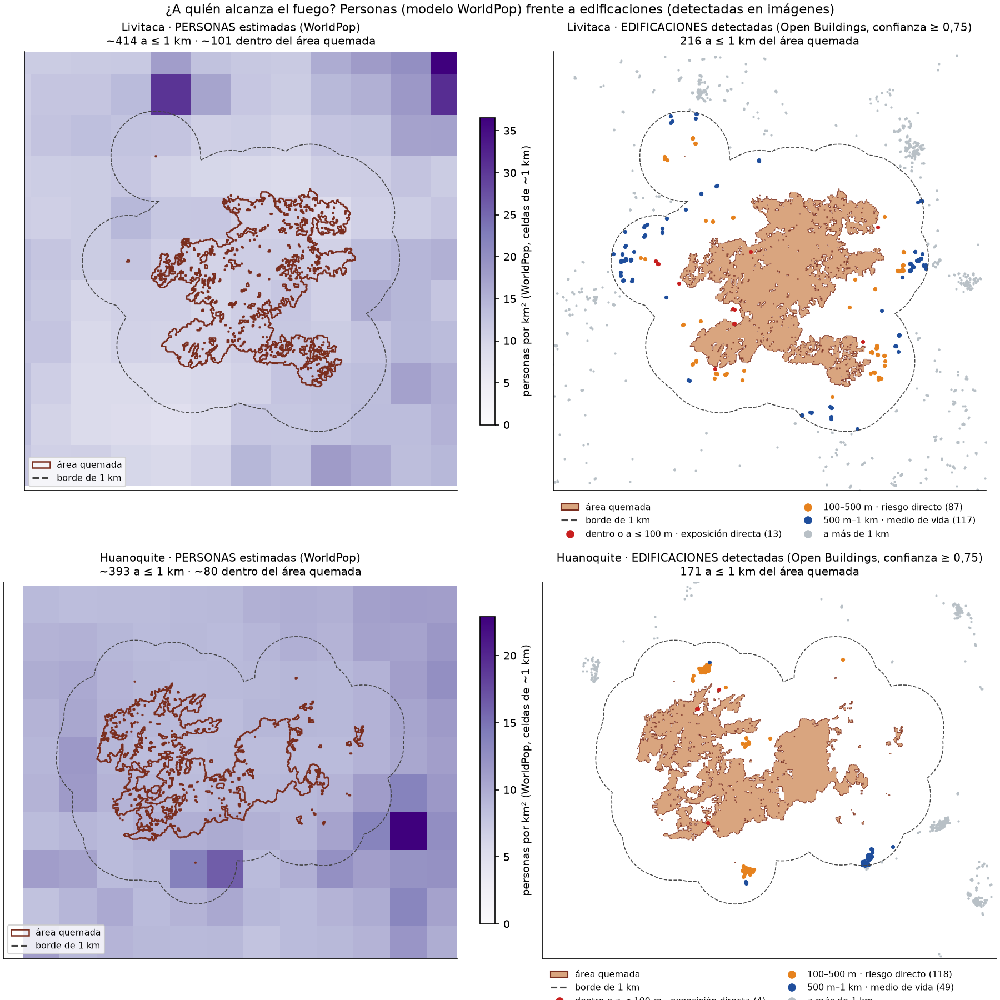
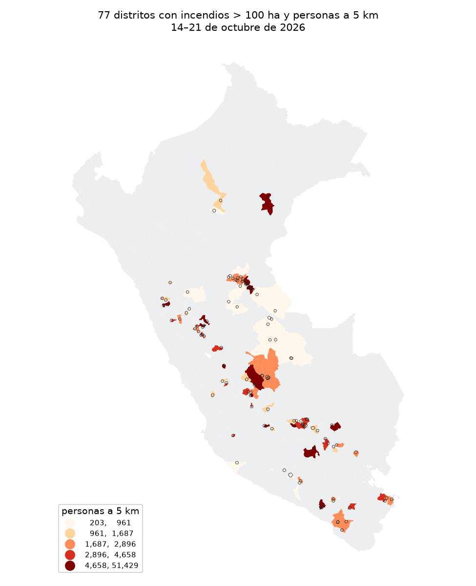

# Incendios en el Perú vistos desde el espacio

Ciencia de Datos con Python · Diplomado en Data Science (QLAB) · 21 de octubre de 2026
¿A quién alcanza el fuego? Una lectura antropológica con datos satelitales.

## 1. Pregunta

**¿A quién alcanzan los incendios de octubre de 2026, y qué es lo que se quema en los territorios
de comunidades campesinas quechuas del Cusco?**

- En todo el país: personas a 5 km de cada incendio (WorldPop).
- A fondo, en dos incendios del Cusco con cielo despejado: **Livitaca** (Chumbivilcas) y
  **Huanoquite** (Paruro). Se mide el área quemada (dNBR) y qué cobertura se quemó.

## 2. Datos y fechas

| Dato | Fuente | Fecha | Tipo |
|---|---|---|---|
| Focos de calor (S-NPP, NOAA-20, NOAA-21) | NASA FIRMS, VIIRS «South America 7d» | 14–21 oct 2026, descarga 21 oct | Puntos |
| Límites distritales | `juaneladio/peru-geojson` (INEI, 1 834 distritos) | — | Polígonos |
| Población | WorldPop 2020, 1 km, *unconstrained* | 2020 | Raster |
| Imágenes | Sentinel-2 L2A, Planetary Computer | ver tabla del método | Raster, 20 m |
| Cobertura | ESA WorldCover | 2021 | Raster, 10 m |
| Relieve | Copernicus DEM GLO-30 | — | Raster |
| Edificaciones | Google Open Buildings v3 (bloques S2 `911` y `917`) | 2023 | Puntos |

## 3. Método y decisiones

| Etapa | Notebook | Qué se hizo y qué se decidió |
|---|---|---|
| Descargar | `01_datos_mapa_base.ipynb` | Todo público y sin clave; cada archivo se baja una vez |
| Mapa base | `01` | Distritos, relieve sombreado (Copernicus DEM) y focos de la región |
| Cobertura | `01`, `03` | WorldCover; en el notebook 3 se cruza a 20 m con el área quemada |
| Focos | `02_focos_incendios.ipynb` | 9 949 → 8 587 focos: −1 336 de confianza baja, −26 fuentes fijas (mismo píxel de 375 m con calor en ≥ 5 de 8 días), 0 cerca de volcanes |
| Incendios | `02` | Focos a ≤ 1 km **y** ≤ 48 h = un incendio (grafo + componentes conectadas). VIIRS mide en píxeles de 375 m y un fuego puede reavivarse al día siguiente. Huella = píxeles de 375 m × 14,06 ha. Se analizan los de huella > 100 ha (por debajo, la mayoría son quemas agrícolas) |
| Área quemada y relieve | `03_raster_cusco.ipynb` | NBR con B8A y B12 (20 m), reflectancia corregida (offset −1000), máscara SCL de nubes, sombras y agua. **dNBR sembrado con focos**: manchas continuas con dNBR ≥ umbral que tocan a ≤ 1 km un foco VIIRS. Dos umbrales: 0,27 (conservador) y 0,10 (amplio, para pastizal). Relieve 3D con Copernicus DEM a 30 m |
| Personas y viviendas | `04_personas_viviendas.ipynb` | Edificaciones (Open Buildings, confianza ≥ 0,75) y personas (WorldPop repartido en sub-celdas de 100 m) dentro del área quemada amplia, a ≤ 100 m, ≤ 500 m y ≤ 1 km |
| Exportar | `05_exportar_contexto.ipynb` | `datos/procesados/tablero.json` (0,5 MB), que lee el tablero `app.py` |
| Contexto | `05` | Reportes COEN-INDECI frente a las mediciones satelitales, lado a lado y sin sumarlos |

Imágenes Sentinel-2 usadas (nubes medidas **dentro de la zona del incendio** con la capa SCL):

| Incendio | Antes | Después |
|---|---|---|
| Livitaca | 07/10 (0 %) | 17/10 (0 %) |
| Huanoquite | Compuesto: 10/10 (28 % nubes), rellenado con 07/10 (4 %) y 05/10 (0 %) | 17/10 (0,2 %) |

**Por qué no la selva.** Río Tambo (Junín) fue el incendio más grande de la semana, con 1 927 ha
de huella VIIRS. Pero después del fuego, sumando dos imágenes, solo se ve despejado el 33 % de
la zona. En Pucallpa (Manantay, Yarinacocha) las nubes cubren entre 56 % y 99 %. Es temporada de
lluvias: VIIRS (térmico, varias pasadas al día) detecta el fuego, pero Sentinel-2 (óptico) no
puede medir la cicatriz.

## 4. Hallazgos

1. **El fuego grande no es el que toca a más gente.** Hubo 107 incendios con huella > 100 ha en
   77 distritos, y **337 069 personas** viven a 5 km de alguno. El más grande, Río Tambo, tiene
   unas 1 380 personas a 5 km. Uno de 211 ha junto a la ciudad de Abancay tiene 51 429, y la
   periferia de Pucallpa suma unas 75 000 (Yarinacocha 40 765 + Manantay 34 502).
2. **Lo que se quemó en el Cusco es pastizal, no bosque.** Cada incendio se reporta como un rango:
   de dNBR ≥ 0,27 (conservador) a dNBR ≥ 0,10 (incluye la quema leve del pasto seco).

   | Incendio | Pastizal | Bosque | Matorral y cultivo | Total |
   |---|---|---|---|---|
   | **Livitaca** (Chumbivilcas) | **425 – 927 ha** (99,9 %) | 0 ha | ~1 ha | 425 – 929 ha |
   | **Huanoquite** (Paruro) | **381 – 826 ha** (92–93 %) | **24 – 57 ha** (6 %) | 4 – 12 ha | 409 – 895 ha |

   Es coherente con la quema de pastos de la ganadería altoandina, una práctica para provocar el
   rebrote que se escapa de control en plena época seca. Solo en Huanoquite el fuego entró a
   bosque: las franjas de quebrada del sector oeste.
3. **El número depende de las decisiones, y el método estándar subestima el fuego en la puna.** El
   umbral 0,27 (USGS) se calibró en bosques. El pasto seco de octubre parte de un NBR bajo y,
   aunque se queme por completo, cae poco. Con 0,27 queda fuera más de la mitad de la cicatriz que
   se ve en la imagen (Livitaca: 425 frente a 929 ha). La línea de 0,10 coincide con la mancha
   visible en falso color. La huella VIIRS tampoco sirve como sustituto: da 267 ha en Livitaca y
   647 ha en Huanoquite.

4. **El fuego quemó pastos y llegó a la puerta de pocas casas; el riesgo depende del patrón de
   asentamiento.** Edificaciones de Open Buildings por distancia al borde del área quemada:

   | Zona (decisión nuestra) | Qué significa | Livitaca | Huanoquite |
   |---|---|---|---|
   | Dentro del área quemada | Exposición directa: el fuego pasó por ahí | 2 | 2 |
   | ≤ 100 m | Exposición directa: el fuego llegó "a la puerta" | **13** | 4 |
   | ≤ 500 m | Riesgo directo: poblados que el fuego pudo alcanzar | 100 | **122** |
   | ≤ 1 km | Medio de vida: familias cuyos pastos cercanos se quemaron | 216 | 171 |

   En Livitaca (Chumbivilcas) las casas están **dispersas**: estancias familiares junto a sus pastos,
   y por eso más casas quedan pegadas al fuego. En Huanoquite (Paruro) están **agrupadas**: el fuego
   se detuvo a pocos cientos de metros de dos poblados. Exposición no es daño: el satélite no dice si
   una casa se quemó. WorldPop, en cambio, pone ~100 personas dentro del área quemada, donde casi no
   hay techos: a esta escala sirve menos que Open Buildings.

   **Por qué no 5 km aquí:** el radio de 5 km del hallazgo 1 se mide desde los focos VIIRS y sirve
   para el ranking nacional. Aquí medimos desde el área quemada de Sentinel-2; mezclar ambos daría
   números que parecen comparables y no lo son.

5. **Las cifras oficiales también se quedan cortas en la puna.** El COEN-INDECI (Reporte
   complementario N.° 14391, 17/10/2026) registra el incendio de Livitaca en el CP Illayuyo:
   inicio el 14/10 a las 14:30, extinguido el 16/10, **200 ha** de cobertura natural destruida y sin
   daños a personas. Lugar y fechas coinciden con VIIRS, pero el área es menor que la satelital
   (425–929 ha): es una evaluación rápida en campo (EDAN) del 15/10. De **Huanoquite no se encontró
   reporte**: un incendio de 400–900 ha en pastizal, sin daños a personas, puede no llegar al
   registro nacional.









## 5. Limitaciones

- **Un foco de calor no es un incendio:** incluye quemas agrícolas. Por eso se usa el umbral de 100 ha.
- **Las nubes esconden el fuego.** La selva queda fuera del dNBR. Con más pasadas posteriores, o
  sumando Landsat (HLS) o radar (Sentinel-1), se podría reconstruir.
- **Umbral y pastizal.** Se reporta el rango 0,27–0,10. Con 0,10 aumenta el riesgo de contar pasto
  que solo se secó entre las dos fechas; el mapa en falso color sirve de control visual.
- **WorldCover es de 2021**: la cobertura pudo cambiar (nuevas chacras, pasto convertido).
- **WorldPop es un modelo, no un censo.** Reparte la población del censo según luces, caminos y
  cobertura, y puede subestimar a la población rural dispersa.
- **Open Buildings cuenta techos, no hogares**: incluye cocinas, depósitos y corrales techados. Con
  confianza ≥ 0,65 en vez de 0,75, las cifras suben (Livitaca ≤ 500 m: 209), pero el patrón no cambia.
- La imagen posterior de Huanoquite (17/10) coincide con los últimos focos: parte del incendio
  pudo seguir creciendo después.

## 6. Tablero

**Monitor web:** https://claude.ai/artifact/A1GKkoKBUpmC56JLsbdTiP

Tiene seis pestañas: panorama nacional, ¿qué se quemó? (pastizal o bosque), ¿a quién alcanza?
(edificaciones o personas, con el significado de cada distancia), relieve 3D, cifras oficiales y
método y decisiones. La página está en `monitor/index.html`. Sus datos se arman con
`monitor/preparar_datos.py`, que escribe `monitor/datos/*.json`.

Respaldo local: `app.py` (Streamlit) muestra el panorama nacional, qué se quemó, a quién alcanza (con el
significado de cada distancia), las cifras oficiales y la tabla de decisiones del método.

```bash
streamlit run app.py
```

## 7. Cómo reproducir

```bash
pip install -r requirements.txt
jupyter nbconvert --to notebook --execute --inplace 01_datos_mapa_base.ipynb 02_focos_incendios.ipynb 03_raster_cusco.ipynb 04_personas_viviendas.ipynb 05_exportar_contexto.ipynb
```

`comun.py` guarda las rutas y las funciones compartidas. `src_nb/` tiene el código de cada
notebook en texto plano.
